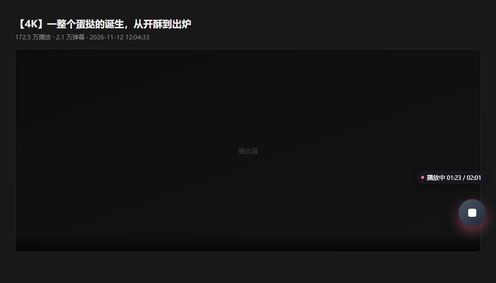
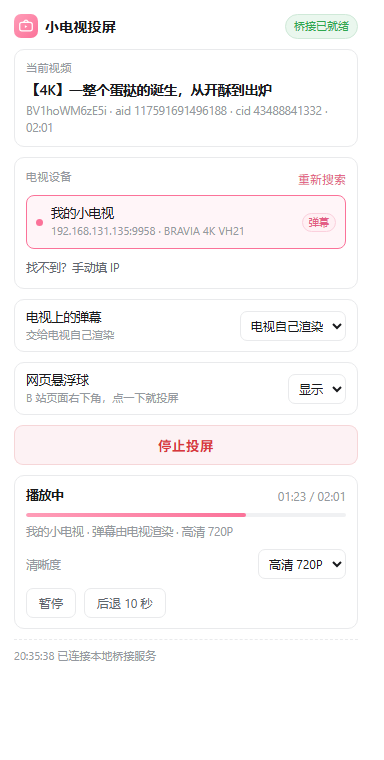

# 小电视投屏 · bili-tv-cast

把 B 站网页视频一键投到电视上的「**云视听小电视**」，走 B 站自己的投屏协议（NVA / 哔哩必连），**不是** DLNA 转码、不经过任何第三方服务器。

装好后：在 B 站视频页点右下角的粉色悬浮球，视频就在电视上接着播，弹幕一起同步。

> 仅供个人学习与自用。协议细节来自公开的抓包分析，与哔哩哔哩官方无关。

| 网页悬浮球（一键投屏） | 控制面板 |
| :---: | :---: |
|  |  |

## 特性

- **原片直连，不转码**：由电脑拉取 B 站播放地址后交给电视播放，画质和手机投屏一个水平（未登录 720P，登录后 1080P，大会员档位另算）
- **弹幕三种模式**：电视自己渲染 / 电脑逐条推送 / 关闭，任选
- **播放中切清晰度**：720P ↔ 360P 随时切，切完自动回到原进度，不丢位置
- **网页悬浮球**：不打开扩展面板也能一键投屏，投屏中再点一下即停止；**播放器全屏时自动隐藏**
- **记住上次的电视**：秒连，不再每次重新扫描；也可以手动填 IP
- **多网卡 / VPN 环境也能搜到**：逐网卡发 SSDP 多播 + 并发扫描子网 9958 端口兜底
- **纯本地**：桥接只监听 `127.0.0.1`，设备发现与控制都在局域网内，不上传任何数据

## 工作原理

```
┌──────────────┐   WebSocket    ┌────────────────────┐   TCP 9958 (NVA)   ┌──────────────┐
│ 浏览器扩展    │ 127.0.0.1:8787 │  本地桥接（Node）   │ ─────────────────► │ 云视听小电视  │
│ (MV3)        │ ◄────────────► │  bridge/server.js  │ ◄───────────────── │  (局域网设备) │
└──────────────┘                └────────────────────┘   进度/状态回报      └──────────────┘
       │                                  │
       │ 读页面 BV/aid/cid、登录凭证        │ UDP 1900 SSDP 发现 + 子网 9958 扫描
       ▼                                  ▼
   bilibili.com                     api.bilibili.com（拉播放地址）
```

为什么需要一个本地桥接进程：Chrome 扩展拿不到原始 TCP / UDP 套接字，而投屏协议是 TCP 9958 上的二进制长连接 + UDP 1900 上的 SSDP 发现，所以必须有个本机进程代劳。

一个实测出来的关键点：**让电视自己去拉流会失败**（电视显示「加载失败（错误码：null）」），所以桥接先替电视把播放地址拉好，再用协议里的 `PlayUrl` 命令把地址递过去。这也是本项目与「直接发 Play 指令」的实现的区别。

另一个坑：B 站网页端（`platform=pc`）的地址**带 Referer 防盗链**，电视端请求时不带 Referer，一律 403。所以这类地址会先登记到本机的流转发服务（8790 端口），电视改连 `http://<电脑IP>:8790/s/...`，由桥接补上 Referer 去 CDN 取流再转发。`platform=html5` 的地址没有防盗链，可以直接给电视。

## 安装

### 方式一：便携包（推荐给普通用户）

到 [Releases](../../releases/latest) 下载最新的便携包（`bili-tv-cast-v1.3.0-portable.zip`），解压后：

1. 双击 **`1.启动桥接.bat`** —— 出现一个黑窗口，保持它开着（关掉就断开投屏）
2. 双击 **`2.安装到浏览器.bat`** —— 它会复制扩展并打开 `chrome://extensions/`
3. 在扩展页右上角打开「**开发者模式**」→「**加载已解压的扩展程序**」→ 选中它帮你弹出的目录
   （默认是 `%LOCALAPPDATA%\BiliTVCast\extension`）

便携包里自带 Node 运行时，电脑上不用装任何东西。

### 方式二：源码运行（开发者）

需要 **Node.js 18+**（无第三方依赖，不用 `npm install`）：

```bash
git clone https://github.com/hijikadasa-ai/bili-tv-cast.git
cd bili-tv-cast

# 启动桥接（Windows 也可以直接双击 1.启动桥接.bat）
node bridge/server.js

# 装扩展：直接「加载已解压的扩展程序」指向本仓库的 extension/ 目录
```

`1.启动桥接.bat` 会优先用包内的 `node\node.exe`，没有则回落到系统 `node`，两种方式都能跑。

## 使用

1. 电视上打开「云视听小电视」App，确认电视和电脑在同一个局域网
2. 电脑浏览器打开任意 B 站视频 / 番剧页
3. **点右下角的粉色悬浮球** —— 直接开投（第一次需要在扩展面板里搜一次电视）

悬浮球：空闲时粉色，投屏中变深色并显示进度，再点一下停止；全屏播放时会自动隐藏。
需要暂停、切清晰度、换电视时，点工具栏的小电视图标打开面板。

## 常见问题

<details>
<summary>电视显示「加载失败（错误码：null）」</summary>

投屏指令到了电视，但电视自己拉流被 B 站拒了。本项目已改为「电脑拉流 + `PlayUrl` 递地址」，正常不会再出现。
如果仍然出现：确认 `1.启动桥接.bat` 窗口里版本号是最新的（旧进程占着 8787 会让扩展连到旧代码），以及浏览器里的扩展点过「重新加载」。
</details>

<details>
<summary>搜不到电视</summary>

1. 电视上要先打开「云视听小电视」App，别停在待机界面
2. 电脑和电视的 IP 前三段要一致（`ipconfig` 对比电视「设置 → 网络」里的 IP）
3. 路由器关了「AP 隔离 / 客户端隔离」，否则同 WiFi 设备互相不可见
4. 实在不行用面板底部的「手动添加」，直接填 `192.168.1.23:9958`（端口固定 9958）
5. 装了火绒 / 360 等，把 `node\node.exe` 加进白名单
</details>

<details>
<summary>清晰度上不去 1080P</summary>

清晰度是 B 站的账号权限决定的，不是本工具的限制：

| 账号状态 | 可用档位 |
| --- | --- |
| 未登录 | 最高 720P |
| 已登录（普通账号） | 1080P |
| 大会员 | 1080P+ / 1080P60 / 4K / HDR |

在浏览器里登录 B 站后再投屏，扩展会把登录凭证交给桥接去要 1080P。
如果目标档位拿不到，面板的清晰度下方会直接写明原因（例如「高清 1080P 需要先在浏览器登录 B 站」），不会静默降档。

另外：B 站网页端的播放地址带 Referer 防盗链，电视直接请求会 403，所以高清晰度地址由本机 8790 端口代取（桥接窗口会打印「已交给本机转发」）。若电视提示加载失败且日志里反复出现「上游拒绝访问（403）」，是地址过期，重新投一次即可。
</details>

<details>
<summary>弹幕重复 / 带边框</summary>

面板里「电视上的弹幕」有三级：**电视自己渲染**（默认，最干净）／**电脑逐条推送**／**关闭**。
出现重复通常是两层渲染叠加，切到「电视自己渲染」即可；如果电视上完全没有弹幕，改选「电脑逐条推送」。
</details>

<details>
<summary>改了扩展文件不生效</summary>

扩展是从 `%LOCALAPPDATA%\BiliTVCast\extension` 加载的，改完本仓库的 `extension/` 后要重跑
`2.安装到浏览器.bat`，再到 `chrome://extensions/` 点卡片上的「重新加载」，最后刷新 B 站页面。
</details>

## 目录结构

```
.
├── 1.启动桥接.bat           # Windows 一键启动（优先用包内 Node）
├── 2.安装到浏览器.bat        # 复制扩展 + 打开扩展管理页
├── 使用说明.txt              # 面向普通用户的中文说明书
├── bridge/                  # 本地桥接服务（Node，无依赖）
│   ├── server.js            # HTTP + WebSocket 服务、消息路由、端口接管
│   └── lib/
│       ├── ssdp.js          # 设备发现：逐网卡 SSDP + 子网 9958 扫描
│       ├── nva.js           # NVA（哔哩必连）协议编解码与长连接
│       ├── bili.js          # 视频解析、播放地址、弹幕、接口签名
│       ├── proxy.js         # 流转发：替电视补 Referer 去 CDN 取流
│       ├── caster.js        # 投屏会话：起播/进度/弹幕/切清晰度/看门狗
│       └── ws.js            # 极简 WebSocket 服务端实现（不引三方库）
└── extension/               # Chrome / Edge 扩展（Manifest V3）
    ├── manifest.json
    ├── background.js        # 悬浮球投屏引擎（连桥接、下发投屏）
    ├── content.js           # 读取页面视频信息 + 悬浮球 UI
    ├── inject.js            # 主世界脚本，读 __INITIAL_STATE__
    └── popup.{html,css,js}  # 控制面板
```

## 技术要点

- **发现**：每块 IPv4 网卡单独 `bind` + `setMulticastInterface` 发 3 轮 M-SEARCH，同时并发扫本网段 TCP 9958（大网段自动降级 `/24`）。多网卡、装了 ZeroTier/VPN 的机器也能稳。
- **控制**：NVA 帧（`0xFA` 帧头 + 长度 + `[请求ID][类型][方法][长度][JSON]`），连接后先 `SETUP` 握手，再 `PlayUrl` 递流地址；电视用 `OnProgress` / `OnPlayState` 回报进度与状态。
- **起播定位**：电视不认 `nva_ext` 里的 `seekTs`，会从 0 开始，因此桥接在收到首个进度回报后补发一条 `Seek` 回到目标位置。
- **切清晰度**：重新拉一条流 + 重发 `PlayUrl`，再补 `Seek`（电视端的 `SwitchQn` 会自己重拉而失败，所以不用）。
- **防盗链**：`platform=html5` 的地址免 Referer 鉴权，优先用它；`platform=pc` 的地址只能经本机 8790 端口转发（补 `Referer`）后再给电视，否则电视端一律 403。
- **弹幕**：`native` 模式只发 `SwitchDanmaku` 让电视按 cid 自己渲染；`relay` 模式按进度回放 `SendDanmaku`，并以 `时间|内容` 去重。

## 致谢

协议细节参考了这些公开资料，没有它们这个项目做不出来：

- [xfangfang - 分析 Bilibili 客户端的「哔哩必连」协议](https://xfangfang.github.io/028)
- [Macast](https://github.com/xfangfang/Macast) 及其 [接收端插件](https://github.com/xfangfang/Macast-plugins)（B 站投屏接收端的参考实现）

## 免责声明

本项目仅供个人学习、研究与自用，请勿用于商业用途。使用本工具产生的任何后果由使用者自行承担。
请尊重视频平台的用户协议与版权，不要用于任何形式的盗链、二次分发或牟利行为。

## License

[MIT](LICENSE)
